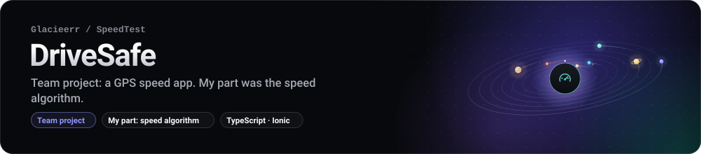

<p><picture>
  <source media="(prefers-color-scheme: light)" srcset=".github/readme/header-light.svg">
  
</picture></p>

> **Team project.** I was responsible for the speed-test algorithm. / **团队项目，我负责测速算法。**

**DriveSafe: a mobile app that tracks the phone's GPS position and shows the live speed in km/h.**

Course project, Computer Science, University at Albany (SUNY).

## My part: the speed algorithm

In [`drive-safe/src/pages/Home.tsx`](drive-safe/src/pages/Home.tsx):

- position fixes with an accuracy worse than 10 m are discarded;
- latitude, longitude and speed are smoothed with Kalman filters;
- when the device reports no speed, the speed comes from the Haversine distance between fixes over the time between them.

The rest of the app was the team's work.

## How to run

The app is in [`drive-safe/`](drive-safe/) and uses the scripts in its `package.json`:

```bash
cd drive-safe
npm install
npm run dev        # Vite dev server
npm run build      # type-check and build
```

The Android project (Capacitor) is in `drive-safe/android/`.

## Tests

Set up in `package.json`: unit tests with Vitest (`npm run test.unit`; `src/App.test.tsx` checks that the app renders) and end-to-end tests with Cypress (`npm run test.e2e`; `cypress/e2e/test.cy.ts`).

## Tech stack

TypeScript, React, Ionic and Capacitor (Geolocation), Vite; Vitest and Cypress for tests.

<!-- License (R3.3 #162): not chosen yet, so until a LICENSE file is added all rights are reserved.
     Course work: check the school's rules on publishing coursework before choosing.
     Team project: a license needs the agreement of every member who wrote code here.
     When decided, add LICENSE and put this section here, e.g.
## License

[MIT](LICENSE) © 2026 Canyuan Ye
-->

---

中文：团队课程项目，纽约州立大学奥尔巴尼分校计算机科学。DriveSafe 测速应用：根据手机的 GPS 定位显示实时速度（km/h）。我负责测速算法（`drive-safe/src/pages/Home.tsx`）：丢弃精度差于 10 米的定位，用卡尔曼滤波平滑经纬度和速度，设备不提供速度时用 Haversine 公式按距离和时间计算。其余部分是团队完成的。
